### 👨‍💻 Hakkımda

Next.js ve React ile web uygulamaları geliştiriyorum. Projelerimin tamamı **[samedcimen.github.io](https://samedcimen.github.io)** adresinde. 
Şu sıralar **Oranoloji** üzerinde çalışıyorum: oranları birebir aynı açılmış geçmiş maçları bulan, banko seçimler, maç asistanı ve kendi Telegram grubu olan kişisel bir oran analizi platformu. 📊 
Bir de **[izleoloji](https://izleoloji.vercel.app)** var: izlediğin film ve dizileri kaydedip arkadaşlarınla paylaşabileceğin bir platform. 🎬 
**[ppbüyüt](https://ppbuyut.com)** ise 19 platformda profil fotoğraflarını tam boyutta gösteren, reklamsız ve kayıtsız bir araç. 🔍

### 🚧 Son zamanlarda uğraştıklarım

<table>
  <tr>
    <td width="50%" valign="top">📊 <b>Oranoloji</b> Oranları birebir aynı açılmış geçmiş maçlar, banko seçimler, maç asistanı, 13 konulu Telegram grubu</td>
    <td width="50%" valign="top">🧮 <b>Maçkolik Sıra</b> Günün İddaa maçlarının saat ve lig sıraları, dönen maçlar ve adresleri</td>
  </tr>
  <tr>
    <td valign="top">⚡ <b>Sürpriz Radar</b> Canlı skor ve oran takibi; devre arasında favorisi geride kalan maçları yakalar</td>
    <td valign="top">⚽ <b>Maç Özetleri</b> Süper Lig maç özetleri, goller ve dakika dakika olaylar</td>
  </tr>
  <tr>
    <td valign="top">📻 <b>Radyoloji</b> Radyo kanallarını tek yerde toplayan dinleme platformu</td>
    <td valign="top">🎬 <b>Dizi Film Sistemi</b> Dizi, film ve oyuncu araştırması, arşive indirme</td>
  </tr>
  <tr>
    <td valign="top">🎟️ <b>Kupon Takip</b> Arkadaş grubunda kim hangi maçta ne verdi: ortak kupon takibi</td>
    <td valign="top">🎮 <b>Queen PlayStation Kafe</b> Kafe için PS3 oyun kütüphanesi</td>
  </tr>
</table>

### 🛠️ Kullandığım araçlar

### 📊 GitHub istatistikleri

<picture>
  <source media="(prefers-color-scheme: dark)" srcset="./profile/istatistik-koyu.svg" />
  <source media="(prefers-color-scheme: light)" srcset="./profile/istatistik-acik.svg" />
  
</picture>
<picture>
  <source media="(prefers-color-scheme: dark)" srcset="./profile/diller-koyu.svg" />
  <source media="(prefers-color-scheme: light)" srcset="./profile/diller-acik.svg" />
  
</picture>

<picture>
  <source media="(prefers-color-scheme: dark)" srcset="https://streak-stats.demolab.com?user=samedcimen&locale=tr&theme=github-dark-blue&hide_border=true" />
  <source media="(prefers-color-scheme: light)" srcset="https://streak-stats.demolab.com?user=samedcimen&locale=tr&hide_border=true" />
  
</picture>

<picture>
  <source media="(prefers-color-scheme: dark)" srcset="https://raw.githubusercontent.com/samedcimen/samedcimen/output/github-contribution-grid-snake-dark.svg" />
  <source media="(prefers-color-scheme: light)" srcset="https://raw.githubusercontent.com/samedcimen/samedcimen/output/github-contribution-grid-snake.svg" />
  
</picture>

### ⏱️ Kodlama süresi

<picture>
  <source media="(prefers-color-scheme: dark)" srcset="./profile/wakatime-koyu.svg" />
  <source media="(prefers-color-scheme: light)" srcset="./profile/wakatime-acik.svg" />
  
</picture>

### 🎧 Son dinlediklerim

